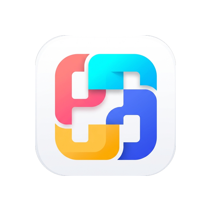
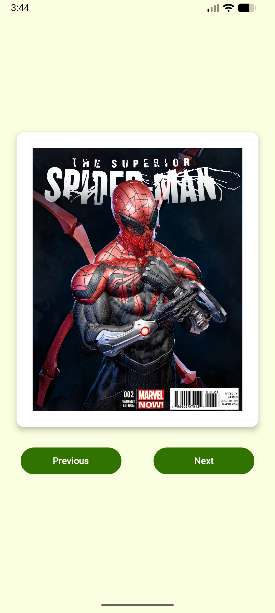

<div align="center">



# Art Space App

</div>


## About the Project

**Art Space** is an interactive Android gallery application built with Jetpack Compose and Material Design 3. It displays curated artwork inside an elevated framed card and lets users cycle through the collection using **Previous** and **Next** controls.

## Key Features

- **Interactive Artwork Navigation**: Browse through 5 bundled gallery images (`image_01`–`image_05`) with wrap-around **Previous** and **Next** buttons powered by Compose state (`remember { mutableIntStateOf(0) }`).
- **Framed Gallery Card**: Presents each image inside an elevated Material 3 `Card` with padded framing and a hairline border.
- **Material 3 & Edge-to-Edge UI**: Uses `Scaffold`, `enableEdgeToEdge()`, and Material 3 theming (`ArtSpaceTheme`) with dynamic color support on Android 12+.
- **Splash Screen Integration**: Configured with `androidx.core:core-splashscreen` (`installSplashScreen()`).

## Screenshots

<div align="center">



</div>

## Tech Stack

- **Language**: [Kotlin](https://kotlinlang.org/) (`2.4.10`)
- **UI Framework**: [Jetpack Compose](https://developer.android.com/jetpack/compose)
- **Design System**: [Material Design 3](https://m3.material.io/)
- **Splash Screen**: [AndroidX Core SplashScreen](https://developer.android.com/develop/ui/views/launch/splash-screen)
- **Target SDK**: 37
- **Min SDK**: 26

## Project Structure

```text
app/src/main/java/com/example/artspace/
├── data/           # Gallery image resource list (Images.kt)
├── ui/theme/       # Material 3 Theme configuration (Color, Theme, Type)
└── MainActivity.kt # Entry point, splash screen setup, and gallery composables
```

## License

This project is licensed under the Apache License 2.0 - see the [LICENSE](LICENSE) file for details.
