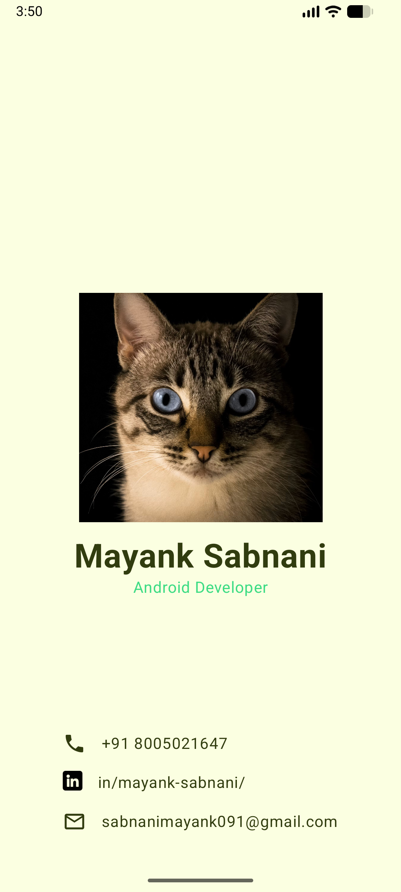

<div align="center">

# Business Card App

</div>


## About the Project

**Business Card** is a single-screen Android application built with Jetpack Compose and Material Design 3. It presents a digital business card layout featuring a centered profile section and a bottom-aligned contact details section, demonstrating `Box` alignment, `Column`/`Row` composition, Material icons, and dynamic theming.

## Key Features

- **Profile & Branding Header**: Displays a profile photo (`R.drawable.my_image`), bold display name, and role title styled with `AndroidGreen` (`#3DDC84`).
- **Contact Information Rows**: Lists phone, LinkedIn, and email details using Material icons (`Icons.Default.Phone`, `Icons.Outlined.Email`) and custom drawable assets (`R.drawable.linkedin`).
- **Material 3 & Edge-to-Edge UI**: Uses `enableEdgeToEdge()`, `Scaffold`, and `BusinessCardTheme` with Android 12+ dynamic color support.

## Screenshot

<div align="center">



</div>

## Tech Stack

- **Language**: [Kotlin](https://kotlinlang.org/) (`2.4.21`)
- **UI Framework**: [Jetpack Compose](https://developer.android.com/jetpack/compose) (BOM `2026.09.00`)
- **Design System**: [Material Design 3](https://m3.material.io/)
- **Icons**: Material Icons Extended (`androidx.compose.material:material-icons-extended`)
- **Build System**: Kotlin DSL Gradle (AGP `9.4.1`, Java 21)
- **Target SDK**: 37
- **Min SDK**: 24

## Project Structure

```text
app/src/main/java/com/example/businesscard/
├── ui/theme/       # Material 3 Theme configuration (Color, Theme, Type)
└── MainActivity.kt # Entry point, MainScreen, MainInformationPart, and ContactInformation
```

## License

This project is licensed under the Apache License 2.0 - see the [LICENSE](LICENSE) file for details.

## Note

This project is a practice exercise from the [Google Android Basics with Compose](https://developer.android.com/courses/android-basics-compose/course) course.
